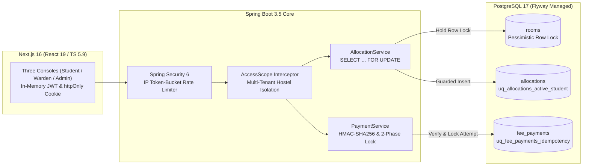
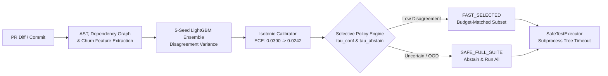

# Bipin

**Software Engineering Student (B.Tech Computer Science '27) &bull; College of Engineering Munnar**  
*Focused on deterministic backend systems, database concurrency, automated test verification, and ML reliability.*

---

## Technical Philosophy

I design software systems where critical invariants are guaranteed by **database locks and constraints** rather than optimistic application-layer checks, and developer tools where **machine learning models know when to abstain** rather than emit overconfident, incorrect predictions.

* **Database-Level Invariants**: Race conditions occur in the gap between a read and a write. Invariants like bed allocation limits, payment idempotency, and application states belong in pessimistic row locks and partial unique indexes.
* **Empirical Rigor & Honesty**: Developer tools and ML systems must transparently report abstention rates, feature constancy, and baseline wall-clock timings rather than claiming superficial savings.
* **Zero-Mock Integration Testing**: Mocks hide entity/DDL mismatches and transaction rollback semantics. CI pipelines must validate behavior against real containerized PostgreSQL instances.

---

## Featured Systems

### 1. [HostelOps &mdash; Multi-Console Hostel Operations Platform](https://github.com/Bipin583/HostelHub-Hostel-Management-System)
*Java 17 &bull; Spring Boot 3.5 &bull; PostgreSQL 17 &bull; Next.js 16 &bull; TypeScript 5.9 &bull; Docker &bull; Testcontainers*

A complete campus accommodation and finance platform with discrete student, warden, and admin consoles, built to eliminate double allocations and payment race conditions at the database level.

#### Core Architectural Guarantees:
* **Pessimistic Row Locking (`SELECT ... FOR UPDATE`)**: Resolves bed allocation contention at the database row level. Avoids optimistic `@Version` retry storms and user-facing retries for short (~1ms), contended transactions.
* **Partial Unique Indexes**: `uq_allocations_active_student` (`WHERE active`) and `uq_applications_one_pending` (`WHERE status = 'PENDING'`) ensure invariants hold even against direct SQL migrations or concurrent workers.
* **Strict Integer Paise Currency**: Money is represented strictly as integer paise across database columns, Java DTOs, and TypeScript models, eliminating IEEE 754 floating-point rounding errors.
* **Payment Settlement Two-Phase Lock**: Settlement acquires locks on the attempt record followed by the invoice row, verifying HMAC-SHA256 callback signatures and preventing duplicate crediting during partial settlements.
* **In-Memory JWT + httpOnly Strict Cookie**: Access tokens live strictly in memory; refresh tokens are stored in `httpOnly`, `Secure`, `SameSite=Strict` cookies. No tokens in `localStorage`.
* **Verified CI Suite**: **232 unit tests** passing in 11.2s; **127 integration executions** across 8 classes running against `postgres:17-alpine` via Testcontainers in GitHub Actions CI.

---

### 2. [ConfTest &mdash; Confidence-Calibrated Regression Test Selection](https://github.com/Bipin583/Conftest)
*Python 3.11 &bull; FastAPI &bull; LightGBM &bull; Streamlit &bull; SQLite &bull; pytest &bull; GitHub Actions*

A regression test selection (RTS) engine for Python CI pipelines that frames test selection as a selective prediction problem under uncertainty, falling back to the full suite whenever uncertainty is high.

#### Core Architectural Guarantees:
* **Selective Prediction & Safe Fallback**: Traditional ML models in CI fail silently by omitting failing tests on unfamiliar diffs. ConfTest quantifies epistemic uncertainty via ensemble score variance and automatically falls back to `SAFE_FULL_SUITE` when uncertain.
* **Post-Hoc Probability Calibration**: Uses Isotonic Regression to map raw classifier scores to calibrated probabilities, reducing Expected Calibration Error (ECE) from 0.0390 to 0.0242.
* **Empirical Validation (183 Held-Out Commits, 86,469 Rows)**:
  * **Failure Recall**: 100.00% (0 escaped test failures).
  * **Test Count Reduction**: 3.11%.
  * **Wall-Clock Reduction**: 0.0% (due to a conservative 97.81% abstention rate that preserves safety).
  * **Scoring Latency**: 3.345 ms per 50 tests.
* **Defensive Subprocess Execution**: `SafeTestExecutor` sanitizes pytest node IDs against flag/command injection, enforces strict process-tree execution timeouts, and terminates rogue worker trees.
* **Complete Interface Ecosystem**: FastAPI REST API, Streamlit visual calibration dashboard, CLI, signed GitHub webhook handler, and automated GitHub Actions PR annotations.

---

## Engineering Invariants & Verified Evidence

| Invariant / Property | HostelOps (Hostel Management) | ConfTest (Test Selection) |
|---|---|---|
| **Primary Guarantee** | Zero bed over-allocation; zero duplicate fee credits | Zero escaped test failures on held-out evaluation |
| **Enforcement Mechanism** | PostgreSQL pessimistic row locks (`SELECT ... FOR UPDATE`) | Selective prediction policy (`SAFE_FULL_SUITE` fallback) |
| **Secondary Defense** | Partial unique indexes (`WHERE active`, `WHERE pending`) | 5-seed ensemble disagreement variance thresholding |
| **Financial / Metric Model** | Integer paise representation (no floating point) | Empirical ECE probability calibration (Isotonic Regression) |
| **Execution Security** | Token bucket rate limiter `(user, IP)` + in-memory JWT | Node ID argument sanitizer + subprocess tree kill |
| **Automated Verification** | 232 Unit Tests + 127 Testcontainers Integration Executions | 800+ Pytest Suite + Contract Tests + Label Integrity Script |
| **CI/CD Pipeline** | GitHub Actions parallel matrix with Docker build | GitHub Actions RTS selector + PR comment reporter |

---

## Technical Skills

| Layer | Technologies |
|---|---|
| **Core Languages** | Java (17/21), Python (3.11+), TypeScript, JavaScript, SQL |
| **Backend & Services** | Spring Boot 3.5, Spring Data JPA, Spring Security 6, FastAPI, REST, Pydantic |
| **Databases & Storage** | PostgreSQL 17, Flyway, SQLite (WAL mode), Hibernate (ddl-auto: none), SQLAlchemy |
| **Frontend Architecture**| React 19, Next.js 16 (App Router), Vanilla CSS, Responsive UI Design |
| **DevOps & Cloud** | Docker, Docker Compose, GitHub Actions CI/CD, Maven (Surefire/Failsafe), Linux |
| **Testing & Quality** | JUnit 5, Testcontainers, AssertJ, pytest, pytest-cov, Ruff, Black, Static Analysis |
| **Systems & Reliability** | Database Concurrency, Row-Level Locking, Idempotent APIs, Uncertainty Estimation, Calibration |

---

## Professional Highlights & Practices

* **Schema Drift CI Enforcement**: Using Flyway with `ddl-auto: none` and asserting entity/migration parity via `SchemaAgreementIT` so schema drift breaks CI rather than production.
* **Audit Trail with Secret Redaction**: Custom Spring AOP aspect (`@Audited`) redacting `password|secret|token|credential` before writing JSON payload diffs to the audit table.
* **Transparent Limitations**: Openly documenting model assumptions, constant training features, and wall-clock realities in RTS developer tooling.

---

## Contact & Links

* **GitHub**: [@Bipin583](https://github.com/Bipin583)
* **LinkedIn**: [linkedin.com/in/bipin-583](https://linkedin.com/in/bipin-583)
* **Email**: [b64957853@gmail.com](mailto:b64957853@gmail.com)
* **Location**: Kerala, India &bull; Open to On-site / Remote Internships and Full-Time Roles (2027)
